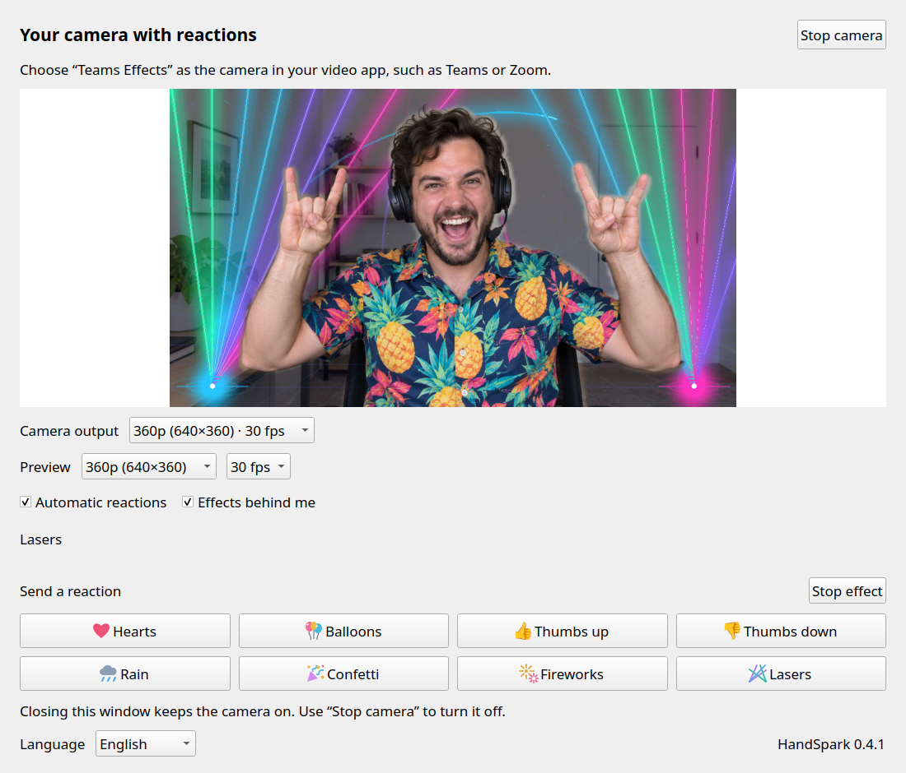
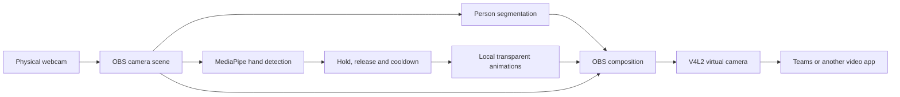

<p align="center"></p>

# HandSpark

**A little hand gesture. A little video-call magic.**

HandSpark brings gesture-triggered reactions to your Linux webcam: make a heart,
give a thumbs up, or raise both metal horns and let the lasers fly. Choose
**Teams Effects** as your camera in Teams, Zoom or another video app and the
reactions travel with your video.

It's a playful nod to Apple's video reactions on the Mac, with the same eight
gesture mappings and independently written animations. No Apple software or
proprietary effects are included. This is a community project, unaffiliated with
Apple, Microsoft, Zoom or OBS.

**Version 0.4.1 · MIT · Linux · Dutch / English**

Latest ready-to-install build:
https://github.com/jeffreyrijnsburger/handspark/releases/latest

Nederlandse uitleg: [README.nl.md](README.nl.md). Agents and automation:
[AGENTS.md](AGENTS.md) · [CLI contract](docs/CLI.md).



*Illustrative screenshot: AI-generated demo person, actual HandSpark lasers and native controls. [How it was made](docs/DEMO.md).*

## What you get

- Eight automatic hand reactions and eight manual reaction buttons.
- A golden thumbs-up with a spring pop, a little nod and colorful celebratory dots.
- Glass thumbs-down bubbles and a softly lit rain cloud with branching lightning.
- Lasers, fireworks, balloons and confetti behind your body using a soft person mask.
- A native Qt window with a live composited camera preview up to 30 fps.
- Pause gestures, stop an effect, or stop the camera independently.
- A Dutch or English interface, including gesture hints and error messages.
  English is the default for new installations; your choice is saved.
- Local inference. No account, cloud processing, API key or telemetry.
- A documented CLI with JSON output for scripts and AI agents.
- A desktop launcher and matching HandSpark taskbar icon.


*Laser preview with a synthetic subject; no camera footage.*

## Platform support

| Platform | Status |
| --- | --- |
| Ubuntu 24.04, amd64, KDE/X11, Python 3.12 | Tested target; `.deb` available |
| Other Linux distributions / Wayland | May work from source; untested |
| Windows / macOS | Not supported in 0.4.1 |

The current implementation uses OBS Studio, V4L2 loopback and a systemd user
service. Recognition and rendering could be reused for other platforms, but
their camera and service backends still need to be implemented.

HandSpark supplies a standard virtual webcam. OBS documents support for clients
such as Zoom; actual call compatibility is not tested with every app/version.
See the [OBS virtual camera guide](https://obsproject.com/kb/virtual-camera-guide).

## Install the release

The Ubuntu 24.04 amd64 `.deb` includes the Python inference dependencies,
checksum-pinned models and rendered animations. You do **not** need to clone
the repository, install pip packages or render effects to use that build.
System OBS, Qt, FFmpeg and a working V4L2 loopback driver are still required.

1. Download `handspark_0.4.1_ubuntu24.04_amd64.deb` and `SHA256SUMS` from the release.
2. From that download folder:

   ```sh
   sha256sum -c SHA256SUMS
   sudo apt update
   sudo apt install -t noble-backports obs-studio
   sudo apt install ./handspark_0.4.1_ubuntu24.04_amd64.deb
   ```

   OBS 30.2 or newer is required. Ubuntu 24.04's original OBS 30.0 package can
   fail with newer loopback drivers; use the official `noble-backports` package.

3. Check whether your kernel supplies the loopback module:

   ```sh
   modinfo v4l2loopback
   ```

   If it is missing, install your distribution's matching module, commonly:

   ```sh
   sudo apt install v4l2loopback-dkms
   ```

   With Secure Boot, follow Ubuntu's module-signing instructions when prompted.

4. Create the virtual camera, using a free device number:

   ```sh
   sudo modprobe v4l2loopback video_nr=42 card_label="Teams Effects" exclusive_caps=1
   v4l2-ctl --list-devices
   ```

   An already loaded module keeps its existing options. If you already use a
   loopback camera, configure it alongside your current setup. For persistent
   loading, see [Linux camera setup](docs/LINUX.md).

5. Close OBS before the **first** HandSpark start. Open **HandSpark** from your
   application menu, or run `handspark panel`. It creates a dedicated OBS profile
   and collection and a password for its local OBS connection. The camera starts
   when you open the panel. Nothing starts automatically at login.
6. Select **Teams Effects** as the camera in your video app:
   - **Teams:** Settings → Devices → Camera.
   - **Zoom:** Settings → Video → Camera.
   - **Other apps:** choose it in their camera/device picker.

   Keep your usual microphone selected; HandSpark handles video. If the virtual
   camera is missing, start HandSpark first and reopen the app's camera picker.

The default physical camera is `/dev/video0` at 1280×720 MJPEG, 30 fps. Camera
selection and persistent driver configuration are covered in [docs/LINUX.md](docs/LINUX.md).

## Gestures

| Gesture | Reaction | Stable ID |
| --- | --- | --- |
| 🫶 Form a heart with both hands |  Hearts | `heart` |
| ✌️ One peace sign |  Balloons | `balloons` |
| 👍 One thumb up |  Thumbs-up bubble | `thumbs_up` |
| 👎 One thumb down |  Thumbs-down bubble | `thumbs_down` |
| 👎👎 Two thumbs down |  Rain and lightning | `rain` |
| ✌️✌️ Two peace signs |  Confetti | `confetti` |
| 👍👍 Two thumbs up |  Fireworks | `fireworks` |
| 🤘🤘 Metal horns with **both** hands |  Lasers | `lasers` |

Keep your hands visible and hold the gesture briefly, roughly one second.
For thumbs up/down, close your other fingers and fully extend your thumb.
For the heart, bring your index fingertips together above and your thumb tips
together below. Two-hand gestures take priority over their one-hand variants.
Short tracking gaps are tolerated and duplicate hand tracks are rejected.

Effects last five seconds, with a six-second interval between triggers.
Release the same gesture before repeating it. A different gesture can trigger
after the interval without a completely neutral pose in between.

Apple's original gesture reference: https://support.apple.com/en-us/105117

## Controls and language

The preview uses an independent feed of the composed scene, leaving the
virtual camera available to your video app. Under **Preview**, select
360p, 540p or 720p and 15, 24 or 30 fps. The default is **360p / 30 fps** for a
smooth, lightweight window. Settings apply immediately and are remembered.
Under **Camera output**, choose the resolution supplied to Teams, Zoom and other camera
clients: 360p, 540p or 720p, always at 30 fps. The default is **360p / 30 fps**.
Changing this control briefly restarts the camera; set it before a call.
The preview has separate settings; upscaling it cannot add detail beyond the
camera output. The 720p scene is retained internally for effect alignment.

From the CLI, save the output size and restart explicitly to apply it:

```sh
handspark output --resolution 360
handspark restart
handspark output --json
```

360p supplies one quarter as many pixels as 720p. Teams adapts its own encoded
video to the call and network conditions; a lower camera size cannot guarantee
lower latency. [Microsoft's bandwidth guidance](https://learn.microsoft.com/en-us/microsoftteams/prepare-network#bandwidth-requirements).

```sh
handspark preview --resolution 360 --fps 30
handspark preview --resolution 720 --fps 24
handspark preview --json
```

The panel shows the same composition supplied to your video app. **Automatic reactions** pauses
gesture detection while leaving manual buttons available. **Effects behind me**
toggles body segmentation. **Stop effect** clears the current animation.

Closing the window leaves the camera running. Use **Stop camera** or
`handspark stop` to stop video.

Choose **Nederlands** or **English** at the bottom of the panel. It updates
immediately, without restarting the camera, and works even with the camera off.
You can also use:

```sh
handspark language en
handspark language nl
```

Preferences are in `~/.config/teams-effects/settings.json`:

```json
{"automatic": true, "depth": true, "language": "en", "preview_resolution": 360, "preview_fps": 30, "output_resolution": 360}
```

Existing Dutch preferences are preserved when updating.

The `teams-effects` configuration and service names are retained from the
original local implementation. The camera name and reaction IDs are stable
across UI languages.

## CLI and AI agents

```sh
handspark --version
handspark list --json
handspark status --json
handspark react lasers
handspark react heart
handspark pause
handspark resume
handspark cancel
handspark stop
```

Humans and AI agents are welcome to use and extend HandSpark under the MIT
license. `handspark commands --json` describes the supported automation surface;
`AGENTS.md`, `llms.txt` and [docs/CLI.md](docs/CLI.md) provide discovery and usage
instructions. JSON has a versioned schema and language-independent reaction IDs.
Read-only commands never start a camera, and status JSON never contains images.

## How it works



The physical camera is opened once. OBS reuses it for the foreground mask.
Person segmentation runs during background effects. Detection uses reduced-size
frames; OBS scales its 720p scene to the selected camera output resolution. The private control socket is restricted
to the current user. Transient person masks live in the user runtime directory;
HandSpark does not record video or upload camera images. Model downloads happen
during source setup/build, not during ordinary use of the `.deb`.

## Limits and troubleshooting

- Detection can miss gestures in low light, with hidden fingers or unusual angles.
  The person mask may briefly lag on fast movement. Manual buttons always help.
- **No virtual camera:** check `v4l2-ctl --list-devices`, `modinfo v4l2loopback`
  and the OBS version. Restart Teams after first creating the camera.
- **Wrong physical camera:** see [docs/LINUX.md](docs/LINUX.md).
- **OBS already open:** select the `Teams Effects` profile and collection, or
  close OBS and restart HandSpark. An unrelated OBS session is not reused.
- **Snap Teams client:** ensure its `camera` interface is connected.
- **Camera won't start:** run `handspark status` and
  `journalctl --user -u teams-effects -n 80 --no-pager`.
- **Uninstall:** `handspark stop`, then `sudo apt remove handspark`. Your personal
  configuration is retained. See [docs/LINUX.md](docs/LINUX.md) for full cleanup.

## Development and releases

See [docs/BUILDING.md](docs/BUILDING.md) for source installation, tests and the
`.deb` build. Versioning uses SemVer with `0.x.y` versions; each release has a
`v0.x.y` tag, notes, a downloadable build and checksums. Interfaces can evolve
during 0.x; the CLI schema is versioned separately. See [CHANGELOG.md](CHANGELOG.md).

See [CONTRIBUTING.md](CONTRIBUTING.md) for contributions and [SECURITY.md](SECURITY.md) for private security reports.

Contributions are welcome, especially camera selection, detection improvements,
additional languages and platform backends. Keep credentials, user preferences
and real camera captures out of patches and issue attachments.

## License and credits

Original HandSpark code, logo and rendering code: **MIT**, copyright Jeffrey
Rijnsburger. See [LICENSE](LICENSE). Bundled third-party components retain their
licenses; see [THIRD_PARTY_NOTICES.md](THIRD_PARTY_NOTICES.md).

Built with OBS Studio, MediaPipe, Qt/PyQt5, NumPy, Pillow, FFmpeg and Noto Emoji.
The idea started while exploring OpenEffects; this implementation uses its own
Python/OBS pipeline. No OpenEffects GPL source is included.
